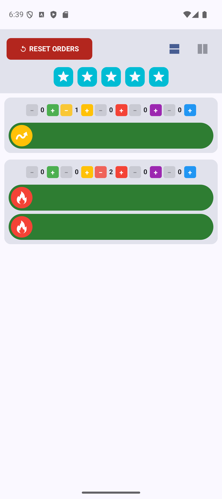
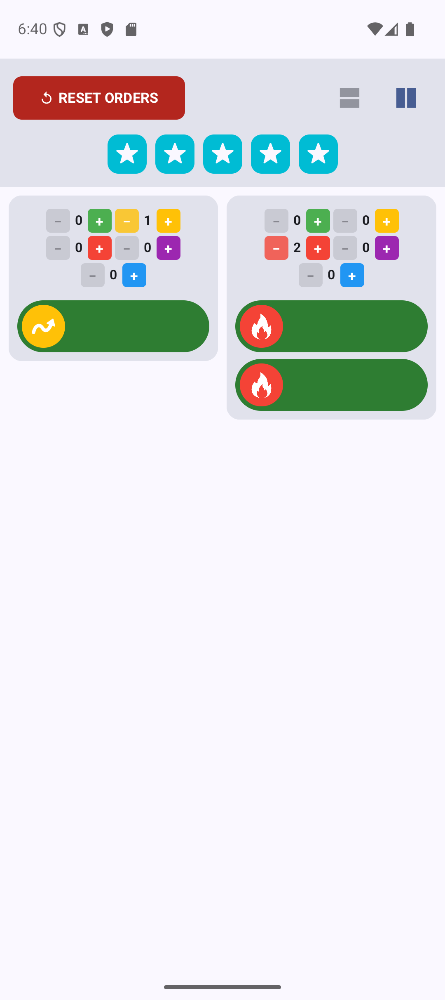

# 🚀 Infinity Orders Tracker

**Твой незаменимый помощник для отслеживания и управления приказами в настольной игре *Infinity***.

> Быстро добавляй, отмечай как потраченные и восстанавливай приказы, чтобы сосредоточиться на самой игре, а не на счете.

## ✨ О проекте

Приложение **Infinity Orders Tracker** создано для того, чтобы облегчить процесс управления тактическими приказами (Orders) в настольной игре *Infinity*. Во время напряженных игровых партий важно иметь полный контроль над текущим количеством примененных приказов.

Наш трекер позволяет:
*   **⚡ Мгновенно добавлять/удалять приказы** в течение игрового раунда.
*   **✅ Отмечать приказы как потраченные**, отслеживая их использование.
*   **🔄 Восстанавливать все приказы** в начале нового игрового цикла, что идеально соответствует правилам игры.
*   **🎯 Минимизировать отвлечения** на подсчет и ведение бумажных записей.

## 🎯 Основные функции

| Функция | Описание                                                                                           |
| :--- |:---------------------------------------------------------------------------------------------------|
| **Быстрое добавление** | Добавляйте новые типы приказов за пару кликов.                                                     |
| **Учет использования** | Визуально отслеживайте, сколько приказов уже было "потрачено".                                     |
| **Сброс раунда** | Кнопка cброса мгновенно восстанавливает исходный запас приказов.                                   |
| **Удобный интерфейс** | Простой и интуитивно понятный дизайн, оптимизированный для быстрого использования во время партии. |

## 📸 Демо (Screenshots & Preview)

| Вертикальная раскладка | Горизонтальная раскладка |
| :---: | :---: |
|  |  |
| Главный экран с текущими приказами и командными токенами | Горизонтальное расположение групп приказов |

## 🛠️ Техническая часть (Tech Stack)

Это Android-приложение, написанное с использованием современных инструментов Google.

*   **Язык:** Kotlin
*   **UI:** Jetpack Compose
*   **Архитектура:** MVVM / MVI (или укажи свою)
*   **IDE:** Android Studio
*   **Build System:** Gradle
*   **Цель:** Высокая производительность и низкий задержка интерфейса.

## ⚙️ Установка и начало работы

### 1. Сбор проекта (для разработчиков)
Если вы хотите скомпилировать или протестировать приложение, используйте Android Studio и следуйте стандартному процессу сборки для модулей `:app`.

### 2. Использование приложения
1.  **Начало игры:** Запустите приложение.
2.  **Первый раунд:** Нажмите кнопку "Начало игры" или "Сброс", чтобы установить начальный запас приказов.
3.  **В течение игры:** Когда вы используете приказ, нажмите соответствующую кнопку или выберите его для отметки "Потрачено".
4.  **Конец раунда:** В начале следующего раунда нажмите "Новый раунд" для автоматического восстановления.

## 🤝 Вклад и развитие

Мы всегда рады новым идеям и улучшению! Если вы нашли ошибку, улучшение UI или хотите добавить новую функцию, пожалуйста:

1.  Форкните этот репозиторий.
2.  Создайте новую ветку.
3.  Создайте Pull Request.

## 📜 Лицензия

Этот проект распространяется под лицензией **MIT**.

---

**Приложение создано для упрощения игрового опыта. Используйте его ответственно!**